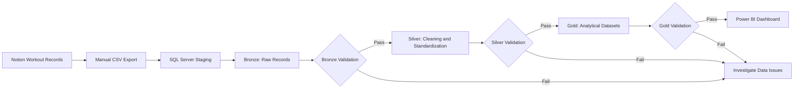

# Phase 1 — Manual End-to-End Data Pipeline

## Overview

The Gym Data Pipeline uses workout records exported from Notion to build a manual data pipeline in Microsoft SQL Server.

The pipeline loads CSV records into a staging table, preserves the original data in Bronze, transforms and standardizes records in Silver, and produces analytics-ready datasets in Gold.

The final Phase 1 output will be a Power BI dashboard displaying maximum weight progression and estimated workout session duration.

**Current status:** Bronze and Silver are implemented and validated for the tested Phase 1 requirements. Gold investigations are in progress. Gold transformations and the Power BI dashboard have not yet been implemented.

Phase 1 focuses on building and understanding a complete manual pipeline before planning the final Phase 2 architecture.

## Objectives

1. **Data ingestion:** Import workout records from Notion into SQL Server through a manual CSV export.
2. **Data storage:** Organize records using staging, Bronze, Silver, and Gold layers.
3. **Data transformation:** Clean, standardize, and aggregate workout records using T-SQL.
4. **Data validation:** Verify record counts, data lineage, transformation accuracy, and analytical results.
5. **Data visualization:** Develop a Power BI dashboard using validated Gold datasets.
6. **Documentation:** Record engineering decisions, implementation progress, validation evidence, and known limitations.

## Architecture

The following diagram represents the intended Phase 1 architecture. Gold and Power BI are planned components and are not yet operational.



### Implementation Status

| Component | Status | Evidence / Notes |
|---|---|---|
| Manual CSV ingestion | Completed | Workout records loaded into SQL Server staging |
| Bronze layer | Completed | 532 raw records preserved |
| Silver transformation | Completed | 532 records transformed |
| Silver validation | Completed for tested scope | Reconciliation, transformations, and sequential rerun checks passed |
| Silver naming standardization | Completed | 21 records corrected; targeted validation passed |
| Gold investigation | In Progress | Session identity and exercise progression investigated |
| Gold transformation | Not Implemented | Business rules and dataset grains approved |
| Power BI dashboard | Not Implemented | Balanced Analytics layout approved |

## Technology Stack

| Technology | Purpose | Status |
|---|---|---|
| Notion | Workout data source | In Use |
| CSV | Manual data export | In Use |
| Microsoft SQL Server Express | Local database engine | In Use |
| T-SQL | Data transformation, aggregation, and validation | In Use |
| Visual Studio Code | Development environment | In Use |
| Git and GitHub | Version control and documentation | In Use |
| Power BI | Dashboard and data visualization | Planned |

The database uses separate Bronze, Silver, and Gold schemas to organize data by processing stage.

## Repository Structure

The following is a partial view of the Phase 1 files relevant to the current development work.

```text

A. Manual End-to-End Pipeline/
├── README.md
├── bronze/
│   ├── a_create_bronze_table.sql
│   ├── b_create_csv_staging.sql
│   ├── c_bulk_insert_staging.sql
│   ├── d_load_staging_to_bronze.sql
│   └── e_validate_bronze.sql
├── database/
├── silver/
│   ├── a_create_silver_table.sql
│   ├── b_bronze_to_silver_transformation.sql
│   ├── c_validate_silver.sql
│   ├── d_apply_workout_log_corrections.sql
│   └── investigations/
│       ├── session_dependencies.sql
│       └── workout_log_naming.sql
├── gold/
│   └── investigations/
│       ├── a_investigate_workout_sessions.sql
│       └── b_investigate_exercise_progression.sql
├── docs/
│   ├── decisions/
│   │   ├── ADR-001-third-set-exclusion.md
│   │   ├── ADR-002-workout-session-duration.md
│   │   ├── ADR-003-two-phase-roadmap.md
│   │   ├── ADR-004-bi-tool-selection.md
│   │   ├── ADR-005-dashboard-layout.md
│   │   └── ADR-006-gold-data-grain.md
│   ├── requirements.md
│   ├── milestones.md
│   ├── progress.md
│   └── validation.md
└── dashboard/
```

This structure does not include every repository file. The Gold investigation scripts are development work, not finalized transformations.

## Implementation

### Data Ingestion and Staging

Workout records are manually exported from Notion as CSV and imported into the SQL Server staging table:

`dbo.exercise_entries_stage`

The staging table retains source fields before records are loaded into Bronze.

### Bronze Layer

**Status:** Completed

- **Source:** `dbo.exercise_entries_stage`
- **Target:** `bronze.exercise_entries`
- **Records:** 532

Bronze preserves the raw workout records before cleaning and business-level transformations.

Each record is assigned a `bronze_id` that is retained in Silver for lineage and traceability.

The source includes workout-log names, exercise names, creation timestamps, weights, and repetitions for up to three sets.

### Silver Layer

**Status:** Completed and Validated for Tested Phase 1 Requirements

- **Source:** `bronze.exercise_entries`
- **Target:** `silver.exercise_entries`
- **Records:** 532
- **Grain:** One row per Bronze exercise entry

The Silver transformation:

1. Converts source timestamps to `DATETIME2(3)`.
2. Converts weights to `DECIMAL(6,2)` and repetitions to `INT`.
3. Trims selected text fields and removes recognized appended Notion links.
4. Converts missing numeric measurements to `NULL`.
5. Retains `bronze_id` for traceability.
6. Standardizes identified workout-log naming inconsistencies.

The transformation uses CTEs, transactions, error handling, and a `NOT EXISTS` check against existing `bronze_id` values.

This prevents repeat inserts during the tested sequential rerun scenario. Existing Silver records are not automatically updated when Bronze values change.

#### Workout Log Standardization

Three inconsistent workout-log names were corrected:

| Original Name | Standardized Name | Records |
|---|---|---:|
| `Back Day 1` | `Pull Day 1` | 6 |
| `Pull Day Day 10` | `Pull Day 10` | 6 |
| `Push Day \| 14` | `Push Day 14` | 9 |
| **Total** | | **21** |

The corrections were tested using transactions and rollback before permanent application.

All 21 targeted records were corrected. The correction script affected zero rows when executed again, and the Silver record count remained at 532.

See [Development Progress](docs/progress.md) and [Validation Log](docs/validation.md).

### Gold Layer

**Status:** Investigation and Design in Progress

Gold will produce two analytics-ready datasets based on the approved dashboard requirements.

#### 1. Exercise Progression

**Planned dataset:** `gold.exercise_progression`

**Grain:** One row per workout session and exercise.

The metric will:

- Use Sets 1 and 2 only.
- Identify the maximum recorded weight for an exercise within a workout session.
- Include repetitions associated with that maximum weight.
- Select the highest corresponding repetitions when maximum weights are tied.
- Apply no minimum repetition requirement.

Workout progression will be ordered by workout session number rather than entry creation timestamp, subject to validation of the numbering convention.

The investigation is documented in [M-002: Exercise Progression](docs/progress.md).

**Current limitation:** The row-level SQL still requires corrections to weight–repetition pairing and NULL handling. Session-level aggregation has not been completed.

#### 2. Estimated Workout Session Duration

**Planned dataset:** `gold.workout_duration`

**Grain:** One row per workout session.

Each `workout_log` identifies a unique workout session.

Estimated duration will be calculated using the difference between the earliest and latest recorded exercise-entry timestamps within the session.

The approved validity rules are:

| Status | Condition | Duration Value |
|---|---|---|
| `VALID` | At least two timestamped entries; duration ≤ 10 hours | Calculated estimate |
| `INVALID` | Duration exceeds 10 hours | `NULL` |
| `INSUFFICIENT_DATA` | Fewer than two timestamped entries | `NULL` |

Some exercise entries were recorded after the actual workout. Consequently, estimated durations measure the span between recorded timestamps, not confirmed workout start and end times.

The investigation is documented in [M-001: Workout Session Investigation](docs/progress.md).

**Current limitation:** Duration classification and calculation have not yet been implemented or validated in Gold.

### Power BI Dashboard

**Status:** Planned

Power BI replaces the previously proposed Streamlit dashboard.

The approved Balanced Analytics layout includes:

- An exercise selector.
- Personal record weight and corresponding repetition KPI cards.
- A maximum weight progression line chart ordered by workout session number.
- An estimated workout duration bar chart.
- Identification of invalid and insufficient duration estimates.

The exercise selector controls exercise progression analysis. The session duration chart remains independent of that selection.

Exercise-specific duration and additional analytical metrics are excluded from Phase 1.

See [Dashboard Requirements](docs/requirements.md).

## Data Validation

SQL validation checks are used to compare records across layers, identify transformation errors, and investigate data quality exceptions.

### Bronze and Silver Validation Results

The initial Silver validation produced the following results:

| Validation | Observed Result | Status |
|---|---|---|
| Bronze–Silver record reconciliation | 532 records in each layer | Passed |
| Duplicate `bronze_id` values | 0 duplicate groups | Passed |
| Missing Bronze identifiers in Silver | 0 missing | Passed |
| Set 1 weight conversion loss | 0 exceptions | Passed |
| Conversion loss across six numeric fields | 0 exceptions | Passed |
| Set 1 weight conversion accuracy | 0 mismatches | Passed |
| Accuracy across six numeric fields | 0 mismatches | Passed |
| Timestamp conversion accuracy | 0 mismatches | Passed |
| Text cleaning accuracy | 0 mismatches against tested rules | Passed |
| Missing required values | 3 incomplete records | Reviewed |
| Invalid nonempty source timestamps | 0 exceptions | Passed |
| Negative measurements | 0 exceptions | Passed |
| Sequential Silver transformation rerun | 532 records; 0 duplicate groups | Passed |
| Workout-log naming corrections | 21 targeted records corrected | Passed |
| Naming correction rerun | 0 additional rows affected | Passed |

These results verify the tested transformation and correction behavior. They do not guarantee that every original workout measurement is accurate.

### Data Quality Findings

Three records contain missing values for both `exercise` and `workout_log`.

| Bronze ID | Bronze Values | Silver Values |
|---|---|---|
| 321 | NULL | NULL |
| 334 | NULL | NULL |
| 335 | NULL | NULL |

The missing values were traced to Bronze and were preserved in Silver.

These three records represent approximately 0.56% of the 532-record dataset.

They remain in both layers for traceability. Their treatment in Gold remains to be finalized.

### Rerun Validation

The Bronze-to-Silver transformation was executed again against unchanged Bronze data.

The Silver record count remained at 532, with no duplicate `bronze_id` groups detected.

This confirms idempotent behavior for the tested sequential rerun scenario. It does not establish protection against concurrent executions or automatic synchronization of changed source records.

The separate one-time workout-log correction was also rerun successfully, affecting zero additional records.

### Gold Validation

**Status:** Pending

Gold validation will verify metric calculations, NULL handling, tie-breaking behavior, uniqueness at each dataset's defined grain, and workout duration classifications.

No final Gold analytical output has passed validation yet.

Detailed validation evidence is maintained in [docs/validation.md](docs/validation.md).

## Setup and Execution

### Prerequisites

- Microsoft SQL Server Express
- Visual Studio Code with a SQL Server connection extension
- Git
- A compatible Notion workout CSV export

Power BI will be required when dashboard development begins.

### Current Manual Execution Sequence

1. Export workout records from Notion as CSV.
2. Import the CSV into `dbo.exercise_entries_stage` in `GymDB`.
3. Load the staging records into `bronze.exercise_entries`.
4. Execute the Silver transformation and validation scripts.
5. Review identified data quality exceptions.
6. Apply the one-time Silver naming correction only when required.

The Silver correction has already been applied to the current local dataset. Its script is retained for documentation and reproducibility.

**Reproducibility note:** The process above reflects the tested local workflow. A complete setup guide for external users, including import configuration and suitable sample data, has not yet been verified.

Gold execution and Power BI setup instructions will be added after their implementations have been tested.

## Engineering Decisions

Major technical decisions are documented in `docs/decisions/`:

| ADR | Decision |
|---|---|
| ADR-001 | Exclude Set 3 from Gold progression metrics and preserve associated repetitions |
| ADR-002 | Identify sessions by `workout_log` and validate estimated durations |
| ADR-003 | Reduce the project roadmap from four phases to two |
| ADR-004 | Use Power BI instead of Streamlit |
| ADR-005 | Use the Balanced Analytics dashboard layout |
| ADR-006 | Separate Gold datasets according to their analytical grain |

These decisions guide the Gold implementation and dashboard development.

## Current Limitations

- **Manual ingestion:** New data must be exported and imported manually.
- **Local environment:** The pipeline depends on a locally configured SQL Server database.
- **Source updates:** Existing Silver rows are not automatically synchronized when Bronze values change.
- **Data quality:** Three incomplete source records remain preserved, with Gold handling pending.
- **Timestamp reliability:** Delayed exercise logging limits the accuracy of estimated workout duration.
- **Measurement accuracy:** Successful numeric conversion does not prove that recorded measurements are correct.
- **Private dataset:** The workout CSV is not provided as a public reproducibility dataset.
- **Incomplete pipeline:** Gold transformations, validation, and Power BI dashboard development remain unfinished.

## AI Usage

AI has been used to explain SQL and Data Engineering concepts, review implementation approaches, identify edge cases, and assist with technical documentation.

Some transformation and validation code was developed with AI assistance and subsequently tested against the local database.

AI-generated or AI-reviewed code is not assumed correct solely because it executes successfully. SQL investigations and validation checks are used to evaluate results.

An ongoing learning objective is to strengthen independent SQL implementation, debugging, and code review skills.

## Next Steps

1. Complete M-001 workout duration implementation and validation.
2. Complete M-002 exercise progression implementation and validation.
3. Create and validate both Gold datasets.
4. Build the approved Power BI dashboard.
5. Complete end-to-end testing and update project documentation.
6. Close Phase 1 and begin planning the final Phase 2.

**Current Phase:** Phase 1 — Manual End-to-End Data Pipeline  
**Current Focus:** Gold Development  
**Repository:** [Gym Data Pipeline](https://github.com/laurogime/Gym_Data_Pipeline)