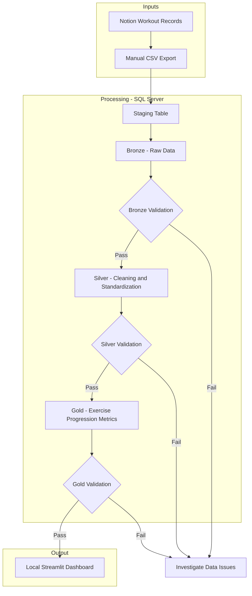

## Overview
Phase 1 focuses on building a manual end-to-end data pipeline using workout records exported from Notion as CSV files. The data is ingested into SQL Server and processed through the Bronze, Silver, and Gold layers of the Medallion Architecture, with the goal of producing structured datasets for visualization in a local Streamlit dashboard.

I chose manual CSV ingestion to strengthen my understanding of fundamental data engineering concepts before introducing APIs and automation in later phases. By working with my own workout dataset, I aim to gain hands-on experience in data ingestion, transformation, validation, and analytical data modeling through a project-based approach.

## Objectives
The primary objective of this phase is to demonstrate how a manual end-to-end data pipeline works.

### Specific Objectives
1. **Data Ingestion**
    - Implement a manual CSV ingestion process that loads workout records exported from Notion into SQL Server.
2. **Data Storage and Architecture**
    - Design and organize the database using the Bronze, Silver, and Gold layers of the Medallion Architecture to separate raw, cleaned, and analytics-ready data.
3. **Data Transpormation**
    - Develop SQL transformations to clean, standardize, and structure raw workout records into reliable datasets for exercise progression analysis.
4. **Data Quality and Validation**
    - Implement validation checks to identify missing, invalid, or duplicate records and verify data integrity throughout the pipeline.
5. **Data Visualization**
    - Develop a local Streamlit dashboard to visualize exercise progression, including maximum recorded weights over time.
6. **Technical Documentation**
    - Document the pipeline architecture, SQL scripts, engineering decisions, and execution procedures to support reproducibility and future development.
## Architecture

> **Implementation Status:** Bronze ingestion and Bronze validation are completed. Silver, Gold, and Streamlit dashboard development are currently in progress.

## Technology Stack

## Reporsitory Structure

## Implementation

### Bronze Layer
### Silver Layer
### Gold Layer
### Sreamlit Dashboard

## Data Validation

## Setup and Execution

## Limitation

## AI Usage

