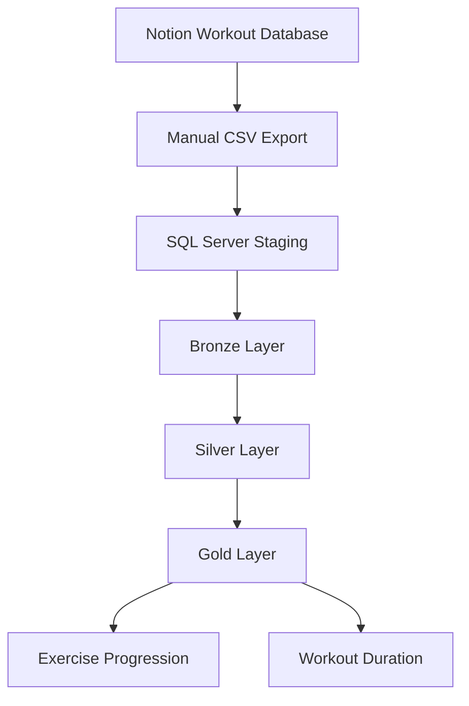

# Phase 1 — Manual Data Engineering Pipeline

**Status:** Technical Implementation Completed — Initial Validation Passed  
**Last Updated:** 2026-11-03  
**Project:** [Gym Data Pipeline](https://github.com/laurogime/Gym_Data_Pipeline)

## 1. Overview

Phase 1 establishes a manual data engineering pipeline that transforms workout records exported from Notion into validated analytical datasets using Microsoft SQL Server Express.

The pipeline follows a Medallion-style architecture consisting of Bronze, Silver, and Gold layers.

The implementation and initial validation of both Gold datasets are complete.

Dashboard development and automated Notion ingestion have been transferred to Phase 2.

## 2. Objectives

- Import workout data from Notion using manual CSV exports.
- Preserve source records in the Bronze layer.
- Clean and standardize records in the Silver layer.
- Produce analytical datasets in the Gold layer.
- Validate transformations, calculations, and data quality.
- Document engineering decisions, implementation progress, and limitations.

## 3. Pipeline Architecture



**Phase 1 scope:** Manual ingestion through validated Gold datasets.

**Phase 2 scope:** Automated Notion ingestion, pipeline orchestration, and an interactive dashboard.

## 4. Technology Stack

| Technology | Purpose |
|---|---|
| Notion | Source workout database |
| CSV | Manual data export |
| SQL Server Express | Local database engine |
| T-SQL | Transformations and validation |
| Visual Studio Code | Development environment |
| Git and GitHub | Version control and documentation |

## 5. Repository Structure

```text
A. Manual End-to-End Pipeline/
├── README.md
├── bronze/
│   ├── a_create_bronze_table.sql
│   ├── b_create_csv_staging.sql
│   ├── c_bulk_insert_staging.sql
│   ├── d_load_staging_to_bronze.sql
│   └── e_validate_bronze.sql
├── database/
├── silver/
│   ├── a_create_silver_table.sql
│   ├── b_bronze_to_silver_transformation.sql
│   ├── c_validate_silver.sql
│   ├── d_apply_workout_log_corrections.sql
│   └── investigations/
├── gold/
│   ├── b_build_exercise_progression.sql
│   ├── c_validate_gold_exercise_progression.sql
│   ├── d_build_workout_duration.sql
│   ├── e_validate_gold_workout_duration.sql
│   └── investigations/
└── docs/
    ├── decisions/
    ├── requirements.md
    ├── milestones.md
    ├── progress.md
    └── validation.md
```

This is a simplified representation of the repository.

## 6. Implementation

### 6.1 Data Ingestion and Bronze Layer

**Status:** Completed

Workout records are manually exported from Notion and loaded through SQL Server staging.

**Staging table:** `dbo.exercise_entries_stage`  
**Bronze table:** `bronze.exercise_entries`  
**Records:** 532

Bronze preserves the source workout records for traceability.

Each record receives a `bronze_id`, which is retained in Silver.

### 6.2 Silver Layer

**Status:** Completed — Validation Passed for Tested Requirements

**Source:** `bronze.exercise_entries`  
**Target:** `silver.exercise_entries`  
**Records:** 532  
**Grain:** One row per Bronze exercise entry

The Silver transformation:

- Converts timestamps to `DATETIME2(3)`.
- Converts weights to `DECIMAL(6,2)` and repetitions to `INT`.
- Standardizes selected text fields.
- Converts missing numerical measurements to `NULL`.
- Preserves `bronze_id` for data lineage.
- Standardizes identified workout-log naming inconsistencies.

Three inconsistent workout-log names affecting 21 records were corrected.

The transformation prevents duplicate inserts under the tested sequential rerun scenario. However, changes to existing Bronze records are not automatically synchronized into Silver.

### 6.3 Gold Layer

**Status:** Both Datasets Implemented — Initial Validation Passed

Gold contains two analytical datasets.

#### A. Exercise Progression

**Table:** `gold.exercise_progression`  
**Records:** 521  
**Grain:** One row per workout session and exercise

Business rules:

- Consider Sets 1 and 2 only.
- Require complete weight–repetition pairs.
- Select the maximum qualifying weight within each session and exercise.
- Preserve the repetitions associated with the selected weight.
- Resolve equal-weight ties using the highest corresponding repetitions.
- Exclude incomplete measurements without modifying Bronze or Silver.

The calculation uses `CROSS APPLY`, `ROW_NUMBER()`, and a transactional full-refresh transformation.

**Validation:** VAL-010 through VAL-015 passed, including controlled edge-case and refresh tests.

#### B. Workout Duration

**Table:** `gold.workout_duration`  
**Records:** 74  
**Grain:** One row per non-NULL `workout_log`

Estimated duration is calculated from the difference between the earliest and latest exercise-entry creation timestamps.

The amended ADR-002 rules classify sessions as follows:

| Status | Condition | Sessions |
|---|---|---:|
| `VALID` | 15 minutes to 10 hours | 62 |
| `SUSPECT_TIMESTAMP` | Below 15 minutes | 9 |
| `INVALID` | Above 10 hours | 3 |
| `INSUFFICIENT_DATA` | Fewer than 2 timestamps | 0 |
| **Total** | | **74** |

Only `VALID` sessions receive a numeric estimated duration.

**Validation:** VAL-016 through VAL-020 passed, covering grain, membership, calculations, classifications, unchanged-source idempotency, and controlled rollback.

Duration values remain estimates based on entry-creation timestamps rather than confirmed workout start and end times.

## 7. Validation Summary

| Component | Validation outcome |
|---|---|
| Bronze and Silver | 532 records reconciled |
| Workout-log standardization | 21 records corrected |
| Exercise progression | 521 Gold records |
| Workout duration | 74 Gold records |
| Exercise progression validation | VAL-010–015 passed |
| Workout duration validation | VAL-016–020 passed |

The detailed validation history is maintained in [docs/validation.md](docs/validation.md).

Passing these tests establishes correctness for the scenarios examined, not universal correctness under every possible input or failure condition.

## 8. Manual Execution Workflow

### Prerequisites

- Microsoft SQL Server Express
- Visual Studio Code with SQL Server connectivity
- Git
- Compatible Notion workout CSV export

### Execution Sequence

1. Export workout records from Notion as CSV.
2. Load the CSV into `dbo.exercise_entries_stage`.
3. Execute the Bronze loading and validation scripts.
4. Execute the Silver transformation and validation scripts.
5. Review source-data quality exceptions.
6. Apply the one-time Silver workout-log correction if required.
7. Execute `gold/b_build_exercise_progression.sql`.
8. Execute `gold/d_build_workout_duration.sql`.
9. Execute the respective Gold validation scripts.
10. Review results and document unexpected discrepancies.

**Reproducibility note:** This describes the local development workflow. A fully independent, clean-environment pipeline setup and execution has not been established by the recorded validation results alone.

## 9. Engineering Decisions

Architecture Decision Records are maintained in `docs/decisions/`.

| ADR | Decision |
|---|---|
| ADR-001 | Set 3 exclusion and progression measurement rules |
| ADR-002 | Session identity and duration-quality classification |
| ADR-003 | Two-phase project roadmap |
| ADR-004 | Historical Power BI dashboard selection |
| ADR-005 | Balanced Analytics dashboard layout |
| ADR-006 | Gold dataset grain definition |

The earlier dashboard decisions are preserved as historical project context. The updated Phase 2 dashboard technology has not yet been finalized.

## 10. Known Limitations

- **Manual ingestion:** New workout data requires manual CSV export and import.
- **Source synchronization:** Existing Silver records do not automatically update when Bronze records change.
- **Local infrastructure:** SQL Server depends on the developer's local environment.
- **Incomplete records:** Three source records have missing workout and exercise identifiers; Gold eligibility rules exclude records without required identifiers.
- **Timestamp reliability:** Creation timestamps are not confirmed workout start and completion times.
- **Controlled validation:** Some rollback and source-change tests used isolated simulations rather than directly testing every failure path of the standalone build scripts.
- **Reproducibility:** The private source dataset and environment require additional setup work for independent execution.
- **Dashboard:** No dashboard is included in Phase 1.

## 11. AI Usage

AI was used to explain technical concepts, generate and review SQL, investigate edge cases, and assist with documentation.

AI-generated implementations were reviewed and tested against the local database.

Successful execution alone was not treated as proof of correctness.

The project emphasizes independent debugging, SQL validation, and critical evaluation of AI-generated code.

## 12. Phase 1 Outcome and Phase 2 Transition

**Phase 1 Outcome:** The manual Bronze–Silver–Gold pipeline is implemented, and both Gold datasets have passed their documented initial validations.

The remaining limitations are recorded in the validation log and development documentation.

**Phase 2 — Automated Workout Analytics System (Proposed)**

Phase 2 will extend the existing foundation with:

- Automated Notion API ingestion.
- Incremental synchronization of new and edited workout records.
- Automated execution of SQL transformations.
- Streamlit-based workout analytics.
- Near-real-time dashboard refresh.
- Monitoring, error handling, and recovery.

The detailed architecture and implementation plan will be finalized separately.

Phase 1 remains the validated manual pipeline foundation for subsequent development.