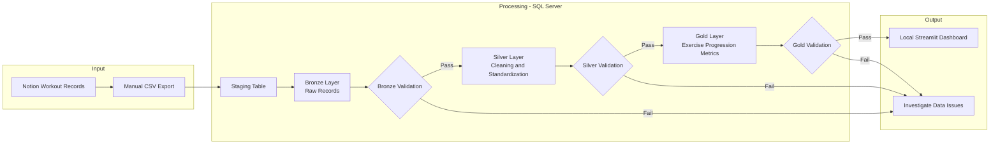

# Phase 1 — Manual End-to-End Data Pipeline

## Overview

This project uses workout records exported from Notion to build a manual data pipeline in Microsoft SQL Server. The source CSV is loaded into a staging table, preserved in a Bronze layer, and transformed into a cleaned Silver dataset.

The longer-term goal of Phase 1 is to create Gold-layer exercise progression metrics and visualize them in a local Streamlit dashboard. **Those components have not been implemented yet.**

I chose manual CSV ingestion so I could study the fundamentals of data ingestion, SQL transformations, data quality, and database design before introducing the Notion API or automated workflows.

## Objectives

The objective of Phase 1 is to understand and build a manual end-to-end data pipeline using my own workout data.

### Specific Objectives

1. **Data ingestion:** Load workout records exported from Notion into SQL Server.
2. **Data storage:** Organize source, raw, cleaned, and analytical data using staging and Medallion Architecture layers.
3. **Data transformation:** Clean and standardize workout records with SQL.
4. **Data validation:** Check record counts, source-to-target lineage, converted values, and data quality exceptions.
5. **Data visualization:** Eventually display exercise progression metrics in a local Streamlit dashboard.
6. **Documentation:** Record the implemented process, test results, and known limitations as development progresses.

## Architecture

The diagram below shows the intended end-to-end architecture for **Phase 1** of the Gym Data Pipeline. It begins with workout records stored in Notion, moves through manual CSV export and SQL Server processing, and ends with a local Streamlit dashboard for analysis and visualization.



### Implementation Status

| Component | Status | Evidence / Notes |
|---|---|---|
| Manual CSV ingestion | Completed | Workout records imported into SQL Server staging |
| Bronze layer | Completed | 532 raw records stored |
| Silver transformation | Implemented | 532 records loaded from Bronze |
| Silver validation | In progress | Transformation checks passed; 3 incomplete records still require review |
| Gold layer | Not started | — |
| Streamlit dashboard | Not started | — |

## Technology Stack

The technologies listed below are **currently used**, not merely planned.

| Technology | Current purpose |
|---|---|
| Notion | Source of personal workout records |
| CSV | Manual export format |
| Microsoft SQL Server Express | Local database engine |
| T-SQL | Schema creation, data transformation, and validation |
| Visual Studio Code | SQL development environment |
| Git and GitHub | Version control and project documentation |

## Repository Structure

This is a **partial view of confirmed files**, not a complete repository inventory.

```text
Gym_Data_Pipeline/
├── README.md
└── A. Manual End-to-End Pipeline/
    ├── README.md
    └── silver/
        ├── a_create_silver_table.sql
        ├── b_bronze_to_silver_transformation.sql
        └── c_validate_silver.sql
```

| Silver script | Purpose |
|---|---|
| `a_create_silver_table.sql` | Create the Silver target table |
| `b_bronze_to_silver_transformation.sql` | Transform and insert Bronze records into Silver |
| `c_validate_silver.sql` | Run reconciliation, conversion, data quality, and rerun checks |

<!-- Update the tree after checking the exact names of the staging and Bronze files. -->

## Implementation

### Data Ingestion and Staging

I manually export my Notion workout records as CSV and load them into the SQL Server staging table, `dbo.exercise_entries_stage`.

The staging step retains the source columns so the records can be transferred into Bronze.

### Bronze Layer

**Status: Completed**

- **Source:** `dbo.exercise_entries_stage`
- **Target:** `bronze.exercise_entries`
- **Records loaded:** 532

Bronze stores the raw workout records before Silver cleaning. A generated `bronze_id` identifies each Bronze record and is retained downstream for traceability.

The source data includes workout dates, exercise names, workout logs, and weight/repetition fields for up to three sets.

### Silver Layer

**Status: Implemented; validation in progress**

- **Source:** `bronze.exercise_entries`
- **Target:** `silver.exercise_entries`
- **Records loaded:** 532
- **Grain:** One row per Bronze exercise entry, with columns for up to three sets

The Silver SQL transformation currently:

1. Converts the source timestamp to `DATETIME2(3)`.
2. Converts weights to `DECIMAL(6,2)` and repetitions to `INT`.
3. Trims selected text values and strips appended Notion links when they match the expected pattern.
4. Represents blank numeric values as `NULL`.
5. Excludes unused source columns and retains `bronze_id` for lineage.

The transformation uses a CTE, a transaction, and error handling. It also checks whether a `bronze_id` already exists before inserting a row. This protects against repeat inserts during ordinary sequential runs, but it does not update Silver records when existing Bronze records change.

### Gold Layer

<!-- Leave blank until Gold tables, transformations, and evidence are implemented. -->

### Streamlit Dashboard

<!-- Leave blank until a working dashboard exists. -->


## Data Validation

Data validation is performed to verify the consistency, completeness, and accuracy of records as they move through the pipeline.

SQL validation queries are used to identify potential data issues, compare records between layers, and verify transformation results.

### Bronze and Silver Validation Results

The Silver layer has completed its initial validation for Phase 1.

A total of **532 records** were successfully transferred from Bronze to Silver. The validation process confirmed record reconciliation, numeric transformation accuracy, timestamp consistency, text cleaning, and idempotency under unchanged source data.

| Validation | Expected Result | Actual Result | Status |
|---|---|---|---|
| Bronze–Silver Record Reconciliation | Matching record counts | 532 Bronze / 532 Silver | Passed |
| Silver Identifier Uniqueness | No duplicate `bronze_id` values | 0 duplicates | Passed |
| Bronze-to-Silver Lineage | No missing Bronze identifiers | 0 missing records | Passed |
| Set 1 Weight Conversion Loss | No unintended NULL conversions | 0 exceptions | Passed |
| All Numeric Conversion Loss | No unintended NULL conversions across six measurement fields | 0 exceptions | Passed |
| Set 1 Weight Accuracy | No detected non-NULL differences | 0 mismatches | Passed |
| Complete Numeric Accuracy | No differences across all six measurement fields | 0 mismatches | Passed |
| Timestamp Conversion Accuracy | No mismatches | 0 mismatches | Passed |
| Exercise and Workout Name Cleaning | No differences from expected cleaned values | 0 mismatches | Passed |
| Missing Required Values | Identify incomplete records | 3 incomplete records | Reviewed |
| Invalid Source Dates | No invalid nonempty timestamps | 0 exceptions | Passed |
| Negative Measurements | No negative weights or repetitions | 0 exceptions | Passed |
| Silver Transformation Rerun | Record count unchanged; no duplicates | 532 records / 0 duplicates | Passed |

### Data Quality Findings

During validation, three records were identified with missing values in both the `exercise` and `workout_log` columns.

| Bronze ID | Bronze Values | Silver Values | Investigation |
|---|---|---|---|
| 321 | NULL | NULL | Missing values originated in Bronze |
| 334 | NULL | NULL | Missing values originated in Bronze |
| 335 | NULL | NULL | Missing values originated in Bronze |

Further investigation confirmed that these missing values were already present in the Bronze layer and were preserved during the Silver transformation.

These records represent approximately **0.56%** of the total dataset.

**Decision:**

- Retain all 532 records in Bronze.
- Retain all 532 records in Silver.
- Preserve the incomplete records for data lineage and traceability.
- Determine appropriate filtering rules for incomplete records during Gold development.

The incomplete records are classified as source-data quality exceptions rather than Silver transformation failures.

### Idempotency Validation

The Silver transformation script, `b_bronze_to_silver_transformation.sql`, was executed again against the unchanged Bronze dataset.

After re-execution, the following results were observed:

| Check | Result | Status |
|---|---|---|
| Silver Record Count | 532 records | Passed |
| Duplicate `bronze_id` Values | 0 duplicates | Passed |

The results confirm that rerunning the current transformation against unchanged Bronze data does not introduce duplicate records.

This verifies idempotency for the tested sequential execution scenario.

The current implementation does not automatically synchronize updates to previously loaded Bronze records or guarantee duplicate prevention during concurrent execution.

### Validation Limitations

Passing the validation checks does not guarantee that the entire dataset is free from errors.

The validation process verifies consistency with the implemented transformation rules, but it does not independently establish the accuracy of measurements originally recorded in Notion.

Some missing measurements may also be legitimate, such as exercises performed with fewer than three sets.

Additional validation rules may be introduced as the analytical requirements evolve.

### Validation Summary

The Silver layer has successfully completed its initial Phase 1 validation.

**Final Results:**

- 532 Bronze records reconciled with 532 Silver records.
- No duplicate Bronze identifiers found in Silver.
- No missing Bronze records identified.
- Numeric, timestamp, and text transformations passed the implemented checks.
- Three incomplete source records identified, investigated, and retained.
- Sequential rerun validation passed without introducing duplicates.

**Silver Layer Status: Completed and Validated for Phase 1 Scope**


### Gold Validation

<!-- Leave blank until Gold has been implemented and tested. -->

## Setup and Execution

### Prerequisites

- Microsoft SQL Server Express
- Visual Studio Code with a SQL Server connection extension
- Git
- A compatible workout CSV export from Notion

### Current Manual Execution Sequence

1. Export the workout records from Notion as CSV.
2. Load the CSV into `dbo.exercise_entries_stage` in `GymDB`.
3. Load the staged records into `bronze.exercise_entries` using the existing Bronze process.
4. Execute the Silver scripts in order: `a_create_silver_table.sql` (initial setup), `b_bronze_to_silver_transformation.sql`, then `c_validate_silver.sql`.
5. Review all validation results and investigate exceptions.

**Reproducibility note:** This is the sequence followed in my local environment, not yet a complete step-by-step setup for an external contributor. Database creation commands, import configuration, and sample data instructions will be documented after they have been reproduced and verified.

### Gold Execution

<!-- Leave blank until implemented. -->

### Streamlit Execution

<!-- Leave blank until implemented. -->

## Current Limitations

- **Manual ingestion:** New workout data must be exported and loaded manually.
- **Local setup:** The pipeline currently depends on a locally configured SQL Server database.
- **Source updates:** The Silver insert process does not synchronize modifications to previously loaded Bronze records.
- **Data quality:** Three records have missing exercise/workout names and require source-level investigation.
- **Conversions:** `TRY_CONVERT` can produce `NULL` for invalid inputs; the current tests do not establish that every source measurement is realistic.
- **Private data:** The source CSV contains personal workout history and is not provided as a public reproducibility dataset.
- **Incomplete pipeline:** Gold and Streamlit have not yet been implemented.

## AI Usage
