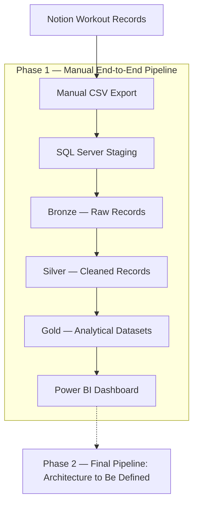

# Gym Data Engineering Pipeline

*A two-phase Data Engineering project transforming workout records into validated datasets and performance analytics.*

## Overview

The Gym Data Pipeline is a personal Data Engineering project that transforms workout records from Notion into structured, validated datasets for exercise progression analysis and dashboard visualization.

The project began as a way to better understand gym performance while applying Data Engineering concepts to a real dataset. It provides practical experience in data ingestion, database design, SQL transformations, data validation, analytical modeling, and business intelligence.

Development is organized into two phases:

- **Phase 1 — Manual End-to-End Pipeline:** Build and validate a complete data pipeline using manually exported workout records, SQL Server, and Power BI.
- **Phase 2 — Final Pipeline:** Develop the final implementation by consolidating the remaining planned engineering work. Its architecture and requirements will be defined after completing Phase 1.

The project is currently in Phase 1, with Bronze and Silver implemented and Gold development underway.

## Problem Statement

Workout records stored in Notion contain useful information about exercise performance, including weights, repetitions, and workout sessions. However, analyzing long-term progression directly from individual records can be inconvenient.

The dataset also contains inconsistencies, missing values, and exercise entries recorded after the actual workout.

The project addresses these challenges by building a structured pipeline that preserves original records, standardizes data, validates transformations, and produces reliable analytical outputs.

## Project Objectives

1. Build a manual data pipeline from Notion CSV exports to SQL Server.
2. Organize data into Bronze, Silver, and Gold layers.
3. Develop SQL transformations that preserve data lineage and handle data quality issues.
4. Validate transformations and analytical calculations using repeatable SQL checks.
5. Track maximum weight progression and estimated workout session duration.
6. Visualize validated Gold datasets using Power BI.
7. Document engineering decisions, limitations, and implementation progress.

## Architecture

The following diagram represents the planned Phase 1 architecture.



**Implementation status:** Manual ingestion, Bronze, and Silver are implemented. Gold development is in progress, and the Power BI dashboard is planned.

Phase 2 is shown as a future development stage rather than a finalized technical architecture.

## Technology

| Technology | Purpose | Status |
|---|---|---|
| Notion | Workout data source | In Use |
| CSV | Manual data export | In Use |
| SQL Server Express | Database engine | In Use |
| T-SQL | Data transformation and validation | In Use |
| Visual Studio Code | Development environment | In Use |
| Git and GitHub | Version control and documentation | In Use |
| Power BI | Analytics dashboard | Planned |

Additional technologies for Phase 2 will be determined during its planning stage.

## Development Phases

### Phase 1 — Manual End-to-End Pipeline

**Status:** In Progress

Phase 1 focuses on implementing the foundational data pipeline using manually exported workout records.

The architecture follows a Medallion approach:

- **Bronze:** Preserve raw workout records.
- **Silver:** Clean, standardize, and validate the source data.
- **Gold:** Produce analytics-ready datasets for dashboard reporting.

The Gold layer will support two metrics:

**1. Maximum Weight Progression**

Track maximum recorded weight and its corresponding repetitions for each exercise across workout sessions. Calculations use Sets 1 and 2 only.

**2. Estimated Workout Session Duration**

Estimate workout duration from exercise-entry timestamps and identify unreliable estimates using defined validation rules.

These datasets will support a Power BI dashboard using the approved Balanced Analytics layout.

**Current progress:**

| Component | Status |
|---|---|
| CSV ingestion | Completed |
| Bronze layer | Completed |
| Silver layer | Completed and validated for tested scope |
| Gold investigations | In Progress |
| Gold implementation | Pending |
| Power BI dashboard | Pending |

Detailed implementation, validation, and engineering decisions are maintained in the [Phase 1 README](A.%20Manual%20End-to-End%20Pipeline/README.md).

### Phase 2 — Final Pipeline

**Status:** Planning Pending

Phase 2 will consolidate the remaining development originally distributed across the intermediate and final phases of the previous roadmap.

Its technical architecture, automation requirements, and deployment scope will be determined after Phase 1 is completed and evaluated.

This avoids committing to infrastructure or implementation details before the manual pipeline is finished.

## Repository Structure

```text
Gym_Data_Pipeline/
├── README.md
└── A. Manual End-to-End Pipeline/
    ├── README.md
    ├── bronze/
    ├── silver/
    ├── gold/
    │   └── investigations/
    ├── database/
    ├── dashboard/
    └── docs/
        ├── decisions/
        ├── requirements.md
        ├── milestones.md
        ├── progress.md
        └── validation.md
```

The Phase 1 directory contains the SQL scripts, investigation queries, technical documentation, and planned dashboard components.

See the [Phase 1 README](A.%20Manual%20End-to-End%20Pipeline/README.md) for the detailed repository structure.

## Getting Started

Clone the repository:

```bash
git clone https://github.com/laurogime/Gym_Data_Pipeline.git
cd Gym_Data_Pipeline
```

Navigate to the Phase 1 directory and review its README for the SQL Server setup, execution sequence, and validation details.

The current pipeline requires Microsoft SQL Server Express and a compatible workout CSV export.

**Reproducibility note:** The original workout dataset is private and is not included as a public sample dataset. A complete external setup and reproduction guide has not yet been validated.

## Data Quality & Validation

Data validation is a core part of the project.

The Bronze and Silver development process includes checks for record reconciliation, identifier uniqueness, data conversion accuracy, missing values, and repeat execution behavior.

### Current Validated Results

- 532 workout records preserved in Bronze and Silver.
- No missing Bronze identifiers or duplicate `bronze_id` groups detected in Silver.
- Initial Silver transformation and sequential rerun validation completed.
- 21 inconsistent workout-log names corrected and verified.
- Three incomplete source records identified and preserved for traceability.

These results apply to the tested data and transformation rules. They do not establish that every original workout measurement is accurate.

Gold calculations remain under development and have not passed final validation.

Detailed investigation and test evidence are maintained in the Phase 1 documentation.

## Engineering Decisions

Major engineering decisions are recorded as Architecture Decision Records (ADRs) under `docs/decisions/`.

These cover the exclusion of third-set measurements, workout session identity and duration validation, the two-phase roadmap, Power BI selection, dashboard design, and Gold dataset grain.

The development process follows a **Build–Learn–Verify** approach: implement independently, investigate unexpected results, validate behavior, and document the evidence.

## Current Limitations

- Data ingestion is manual.
- SQL Server currently runs in a local development environment.
- The source dataset is private.
- Some workout records contain incomplete values.
- Delayed exercise logging reduces timestamp reliability for duration estimates.
- Gold analytical transformations are unfinished.
- The Power BI dashboard has not yet been implemented.
- Phase 2 architecture remains undefined.

## Future Improvements

The immediate priority is to complete and validate the two Gold metrics, develop the approved Power BI dashboard, and verify the complete Phase 1 workflow.

After Phase 1 is finished, the project will move into planning for the final Phase 2.

Future engineering enhancements will be evaluated during that planning process rather than added prematurely to the current scope.

---

**Current Phase:** Phase 1 — Manual End-to-End Pipeline  
**Current Focus:** Gold Development  
**Project Status:** In Progress