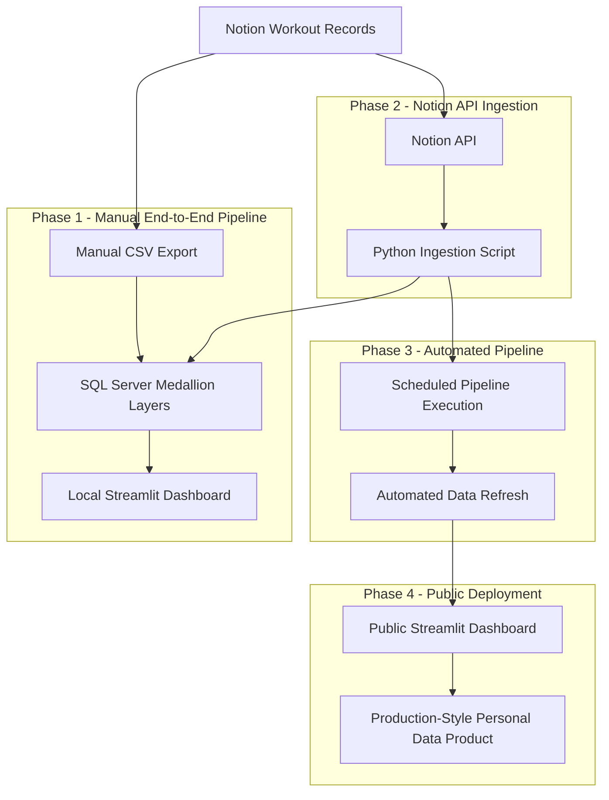

# Gym Data Engineering Pipeline
*A four-phase journey from manual data ingestion to automated analytics and public deployment.*

## Overview
The Gym Data Pipeline is a personal data engineering project designed to transform workout records from Notion into structured, validated datasets for exercise progression analysis and dashboard visualization. I started this project because I wanted a more effective way to measure and understand my gym progression while applying my data engineering knowledge to a real-world problem.

The project is organized into four progressive development phases: Manual End-to-End Pipeline, Notion API Ingestion, Automated Pipeline, and Public Deployment. Each phase introduces additional engineering capabilities and complexity, allowing readers and developers to explore how the system evolves through different implementations.

The first three phases will be preserved as standalone implementations to document the project's technical evolution. Phase 4 will serve as the actively maintained version, providing a publicly deployed dashboard for monitoring and analyzing my workout progression over time.

## Problem Statement

## Project Objectives

## Architecture

## Technology

## Development Phases

### Phase 1 - Manual End-to-End Pipeline

### Phase 2 - Notion API Ingestion

### Phase 3 - Automated Pipeline

### Phase 4 - Public Deployment

## Repository Structure

## Getting Started

## Data Quality & Validation

## Current Limitations

## Future Improvements

