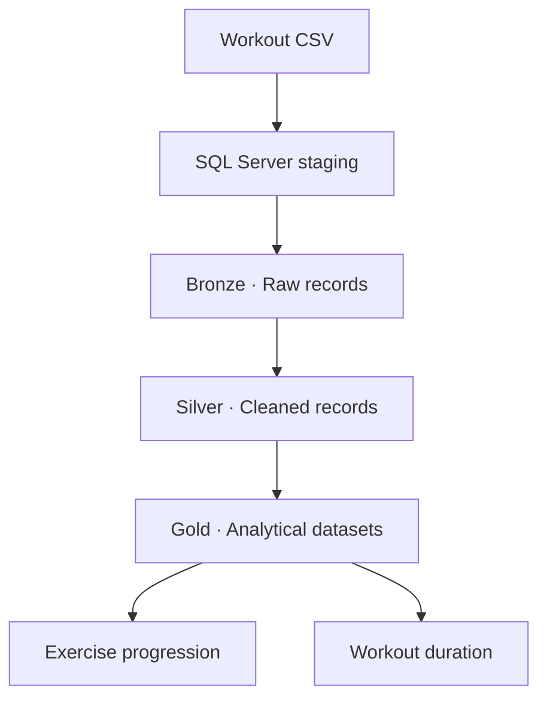

# Gym Data Engineering Pipeline

**Version 1 is a manual SQL Server pipeline that turns workout CSV records into two validated analytics datasets.** The public demo runs on seven synthetic workout entries. You do not need a Notion account, personal workout data, or Version 2 to try it.

## Overview

Workout logs are useful for tracking progress, but individual entries can contain inconsistent labels, incomplete sets, and timestamps that do not reflect when training ended. Version 1 preserves the raw records, cleans and types them, and produces two Gold datasets for comparing exercise performance and estimating session duration.

## Architecture



| Layer | What it does |
|---|---|
| Bronze | Preserves the staged source values and assigns a row ID. |
| Silver | Keeps the Bronze ID for lineage, standardizes labels, and converts timestamps, weights, and reps to typed values. Blank numeric fields become `NULL`. |
| Gold | Builds one row per workout and exercise for progression, and one row per workout for estimated duration. |

Version 1 uses **SQL Server Express** and **T-SQL** on Windows. VS Code is used to run the SQL files. Notion was the original data source, but the demo uses only the synthetic CSV included here.

## Run the Version 1 demo

### Prerequisites

- A local SQL Server Express instance on Windows.
- VS Code with the Microsoft SQL Server extension and a connection to that instance.
- Permission to create the demo database and import a CSV that SQL Server can read.

### First run

1. Clone the repository and open the folder in VS Code.

   ```bash
   git clone https://github.com/laurogime/Gym_Data_Pipeline.git
   cd Gym_Data_Pipeline
   ```

2. Locate [the synthetic CSV](data/sample/exercise_entries_demo.csv) in the repository root's `data/sample/` directory. In VS Code, right-click the file and choose **Copy Path** to get its absolute Windows path.
3. Run the SQL files in the order below. Paths are relative to `A. Manual End-to-End Pipeline/`. Run each file in full. The setup script creates `GymDB_V1_Sample` if needed. For a first run, use a demo database with no pipeline tables from an earlier run. Do not use your personal database.

   | Order | Script | Action |
   |---:|---|---|
   | 1 | `database/database.sql` | Create the demo database and its Bronze, Silver, and Gold schemas. |
   | 2 | `bronze/b_create_csv_staging.sql` | Create the staging table. |
   | 3 | `bronze/c_bulk_insert_staging.sql` | Copy this script into a new scratch query. Replace `PASTE_DEMO_CSV_PATH_HERE` with the absolute path to the synthetic CSV, keeping the surrounding single quotes. Run the scratch copy. Leave the placeholder unchanged in the repository file. |
   | 4 | `bronze/a_create_bronze_table.sql` | Create the Bronze table. |
   | 5 | `bronze/d_load_staging_to_bronze.sql` | Copy staged rows into Bronze. |
   | 6 | `bronze/e_validate_bronze.sql` | Check row counts, IDs, and preservation of the staged values. |
   | 7 | `silver/a_create_silver_table.sql` | Create the Silver table. |
   | 8 | `silver/b_bronze_to_silver_transformation.sql` | Clean and load the Bronze rows into Silver. |
   | 9 | `gold/b_build_exercise_progression.sql` | Build the exercise progression dataset. |
   | 10 | `gold/d_build_workout_duration.sql` | Build the workout duration dataset. |

   If the import cannot open the CSV, check the absolute path and verify that SQL Server has read access to the file. If the loader reports that staging already contains rows, do not import the same CSV again.

4. Confirm the Bronze validation shows **7 staging rows, 7 Bronze rows, and 7 unique Bronze IDs**, with no rows in the difference grid. Then run this read-only verification query and compare the results with the tables below.

   ```sql
   USE [GymDB_V1_Sample];

   SELECT
       COUNT(*) AS silver_rows,
       COUNT(DISTINCT bronze_id) AS unique_bronze_ids,
       COUNT(today) AS rows_with_timestamp
   FROM silver.exercise_entries;

   SELECT set_2_weight, set_2_reps
   FROM silver.exercise_entries
   WHERE workout_log = N'Push Day 2' AND exercise = N'Bench Press';

   SELECT workout_log, exercise, max_weight, max_weight_reps
   FROM gold.exercise_progression
   ORDER BY workout_log, exercise;

   SELECT workout_log, duration_status, estimated_duration_minutes
   FROM gold.workout_duration
   ORDER BY workout_log;
   ```

### Expected demo results

**Silver** returns **7 rows, 7 unique Bronze IDs, and 7 timestamps**. The Push Day 2 Bench Press row has Set 2 weight of `50.00` and Set 2 reps of `NULL`.

**Gold exercise progression** considers Sets 1 and 2 only. It ranks complete weight–rep pairs by weight, then by reps when the weights tie.

| Workout | Exercise | Max weight (kg) | Reps |
|---|---|---:|---:|
| Pull Day 1 | Seated Cable Row | 35.00 | 8 |
| Pull Day 2 | Lat Pulldown | 35.00 | 8 |
| Pull Day 2 | Seated Cable Row | 37.50 | 10 |
| Push Day 1 | Bench Press | 40.00 | 10 |
| Push Day 1 | Cable Pushdown | 17.50 | 10 |
| Push Day 2 | Bench Press | 42.50 | 8 |
| Push Day 2 | Lateral Raise | 10.00 | 10 |

Push Day 1 Bench Press demonstrates the rep tie-break and excludes the heavier Set 3. Push Day 2 Bench Press skips the heavier Set 2 because its reps are missing.

**Gold workout duration** measures the span between the first and last exercise-entry creation timestamps in each session. Fewer than two timestamped entries are classified as `INSUFFICIENT_DATA`. Spans under 15 minutes are `SUSPECT_TIMESTAMP`, and spans over 10 hours are `INVALID`. Only spans from 15 minutes through 10 hours, inclusive, are `VALID` and return a numeric estimate.

| Workout | Duration status | Estimated minutes |
|---|---|---:|
| Pull Day 1 | `INSUFFICIENT_DATA` | `NULL` |
| Pull Day 2 | `INVALID` | `NULL` |
| Push Day 1 | `VALID` | 40.00 |
| Push Day 2 | `SUSPECT_TIMESTAMP` | `NULL` |

### Verify a rerun

With the demo data unchanged, rerun only the **Silver transformation** (step 8 in the script table) and the **two Gold builds** (steps 9 and 10). Then rerun the verification query. Silver should still contain seven rows with seven unique Bronze IDs, and both Gold outputs should match the tables above. Do not rerun the staging or Bronze loads for this check.

## Validation and engineering decisions

The original Version 1 validation covered source-to-target reconciliation, lineage, type conversions, naming corrections, and both Gold datasets. The progression checks are recorded as **VAL-010 through VAL-015**, and the duration checks as **VAL-016 through VAL-020**. The original dataset is private and is not required to reproduce the public demo. Some historical recovery checks used controlled simulations rather than failures injected into the standalone scripts.

The seven-row synthetic demo ran end to end on a fresh `GymDB_V1_Sample`
database using a pre-commit export of the repository files. The CSV loaded
after the loader was set to read LF line endings. Bronze matched staging,
Silver preserved the missing rep count as `NULL`, and both Gold tables
matched the expected results above. With the input unchanged, rerunning
Silver and both Gold builds left Silver at seven rows with seven unique
Bronze IDs and produced identical Gold results.

This was a local test from an exported copy, not a clone of a published release.

- [Version 1 implementation notes](A.%20Manual%20End-to-End%20Pipeline/README.md)
- [Validation log](A.%20Manual%20End-to-End%20Pipeline/docs/validation.md)
- [Architecture decision records](A.%20Manual%20End-to-End%20Pipeline/docs/decisions/)

## Data privacy and limitations

- The sample CSV is synthetic. Keep real exports outside the repository or in the ignored `data/private/` directory. Do not commit machine-specific import paths.
- Ingestion is manual. Silver inserts new Bronze IDs but does not synchronize changes to existing entries.
- Estimated duration reflects when entries were created, not confirmed workout start and finish times.
- Scheduled ingestion and a dashboard are outside Version 1. Version 2 is a separate design effort and does not require the Version 1 database.

## AI usage

AI helped explain concepts, review SQL, identify edge cases, and draft documentation. The project follows **Build → Learn → Verify**, with SQL checks and expected outputs used to evaluate the work.