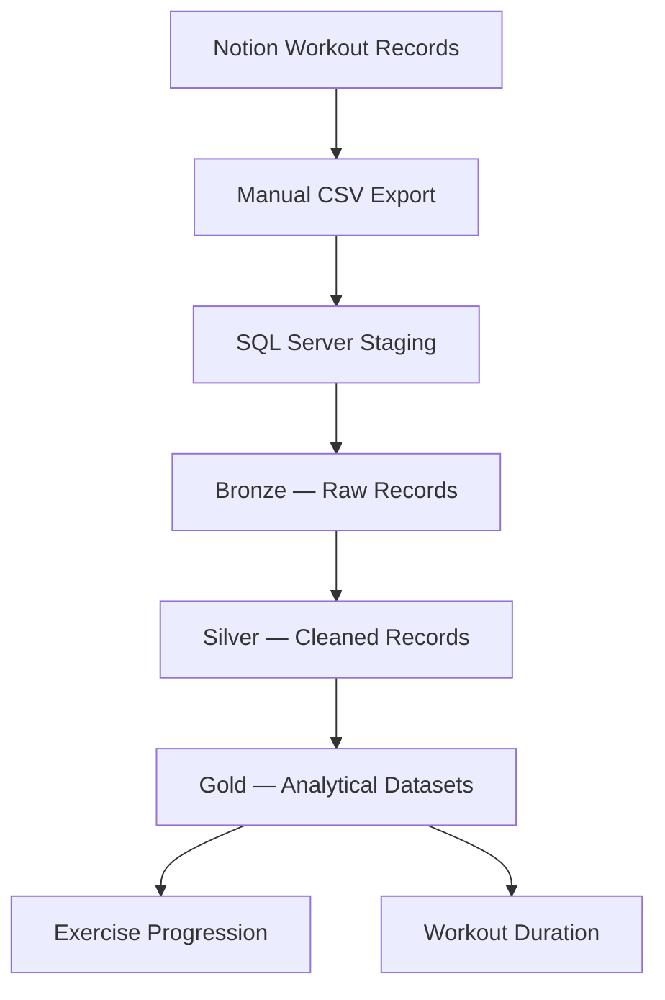
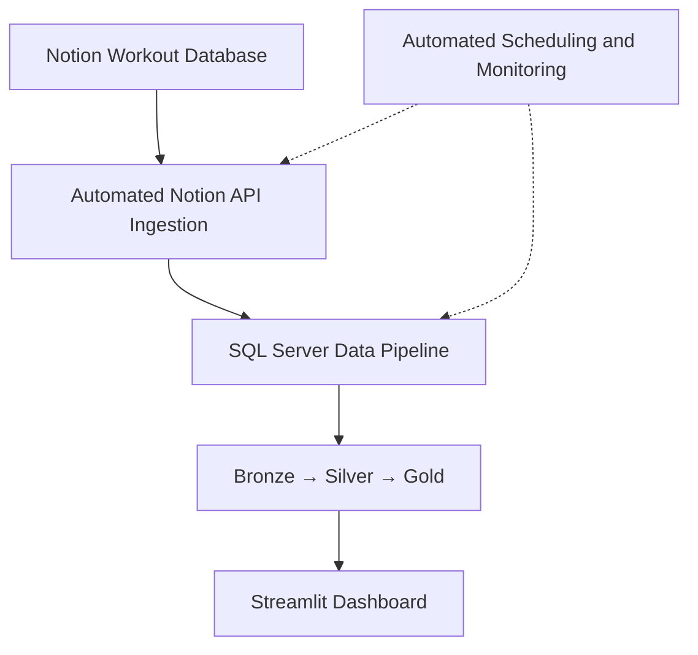

# Gym Data Engineering Pipeline

*A two-phase Data Engineering project transforming workout records into validated datasets and an automated workout analytics system.*

## Overview

The Gym Data Pipeline is a personal Data Engineering project designed to transform workout records from Notion into structured, validated datasets for exercise progression analysis.

The project combines practical Data Engineering skills with a real-world application: tracking gym performance through reliable data processing and analytics.

Development is organized into two phases:

- **Phase 1 — Manual Data Engineering Pipeline:** Implement and validate a manual data pipeline using Notion CSV exports and Microsoft SQL Server.
- **Phase 2 — Automated Workout Analytics System:** Extend the Phase 1 foundation with automated Notion ingestion, pipeline orchestration, and an interactive dashboard.

**Current Status:** Phase 1 technical implementation completed with initial validation passed. Phase 2 planning is next.

## Problem Statement

Workout records stored in Notion contain valuable information about exercise performance, including weights, repetitions, and workout sessions.

However, analyzing long-term progression directly from individual entries is inconvenient. The source data also contains inconsistencies, missing measurements, and unreliable exercise-entry timestamps.

This project addresses these challenges by building a structured pipeline that preserves source records, standardizes data, validates transformations, and produces analytics-ready datasets.

## Project Objectives

1. Build a manual data pipeline from Notion CSV exports to SQL Server.
2. Organize records into Bronze, Silver, and Gold layers.
3. Implement SQL transformations while preserving data lineage.
4. Validate transformations and analytical calculations.
5. Calculate maximum weight progression and estimated workout duration.
6. Document engineering decisions, validation evidence, and known limitations.
7. Extend the validated foundation into an automated workout tracking application in Phase 2.

## Architecture

### Phase 1 — Implemented



### Phase 2 — Proposed



The Phase 2 architecture is provisional and will be refined before implementation.

Phase 2 is intended to reuse and extend the existing Phase 1 transformations rather than duplicate the entire pipeline.

## Technology Stack

| Technology | Purpose | Status |
|---|---|---|
| Notion | Workout data source | In Use |
| CSV | Manual data export | Phase 1 |
| SQL Server Express | Database engine | In Use |
| T-SQL | Transformations and validation | In Use |
| Visual Studio Code | Development environment | In Use |
| Git and GitHub | Version control | In Use |
| Python | Automated ingestion and application development | Proposed for Phase 2 |
| Notion API | Automated source synchronization | Proposed for Phase 2 |
| Streamlit | Interactive workout dashboard | Proposed for Phase 2 |

Power BI was previously selected for the Phase 1 dashboard, but dashboard development has been transferred to Phase 2. The earlier design decisions remain documented.

## Development Phases

### Phase 1 — Manual Data Engineering Pipeline

**Status:** Technical Implementation Completed — Initial Validation Passed

Phase 1 establishes the foundational data pipeline using a Medallion-style architecture.

- **Bronze:** Preserve raw workout records.
- **Silver:** Clean, standardize, and validate source records.
- **Gold:** Produce analytics-ready datasets using approved business rules.

#### Implementation Results

| Component | Status | Records |
|---|---|---:|
| Manual CSV ingestion | Completed | 532 |
| Bronze layer | Completed | 532 |
| Silver layer | Completed | 532 |
| Gold exercise progression | Implemented and validated | 521 |
| Gold workout duration | Implemented and validated | 74 |

#### Gold Dataset 1 — Exercise Progression

**Table:** `gold.exercise_progression`

Calculates the maximum qualifying weight and corresponding repetitions per workout session and exercise.

The metric considers Sets 1 and 2, requires complete weight–repetition pairs, and resolves equal-weight ties using the highest corresponding repetitions.

**Validation:** VAL-010 through VAL-015 passed within their documented testing scope.

#### Gold Dataset 2 — Workout Duration

**Table:** `gold.workout_duration`

Calculates estimated duration using the earliest and latest exercise-entry creation timestamps within a workout session.

The dataset implements four quality classifications:

| Status | Sessions |
|---|---:|
| `VALID` | 62 |
| `SUSPECT_TIMESTAMP` | 9 |
| `INVALID` | 3 |
| `INSUFFICIENT_DATA` | 0 |
| **Total** | **74** |

Only `VALID` sessions receive numeric estimated durations.

**Validation:** VAL-016 through VAL-020 passed within their documented testing scope.

#### Phase 1 Outcome

Both Gold datasets are implemented and available for downstream analytics.

The Phase 1 technical implementation is complete, with known limitations recorded in the project documentation.

Dashboard development is no longer a Phase 1 completion requirement.

Detailed documentation is available in the [Phase 1 README](A.%20Manual%20End-to-End%20Pipeline/README.md).

### Phase 2 — Automated Workout Analytics System

**Status:** Planning

Phase 2 will extend the existing manual pipeline into an automated system intended for daily workout tracking.

Proposed capabilities include:

- Automated ingestion from the Notion API.
- Synchronization of newly created and modified workout entries.
- Preservation of historical workout measurements.
- Automated Bronze, Silver, and Gold processing.
- Streamlit dashboard for exercise progression and workout analytics.
- Near-real-time data refresh.
- Monitoring, error handling, and recovery.

The final technology choices, deployment strategy, and implementation sequence will be determined during Phase 2 planning.

## Repository Structure

```text
Gym_Data_Pipeline/
├── README.md
└── A. Manual End-to-End Pipeline/
    ├── README.md
    ├── bronze/
    ├── silver/
    ├── gold/
    │   └── investigations/
    ├── database/
    ├── dashboard/
    └── docs/
        ├── decisions/
        ├── requirements.md
        ├── milestones.md
        ├── progress.md
        └── validation.md
```

The existing `dashboard/` folder is part of the earlier Phase 1 repository structure; dashboard implementation is deferred.

A dedicated Phase 2 directory will be introduced once its initial architecture is approved.

## Getting Started

Clone the repository:

```bash
git clone https://github.com/laurogime/Gym_Data_Pipeline.git
cd Gym_Data_Pipeline
```

Navigate to `A. Manual End-to-End Pipeline/` and consult its README for the manual SQL Server workflow, implementation details, and validation references.

The pipeline currently requires Microsoft SQL Server Express and a compatible Notion workout CSV export.

**Reproducibility note:** The original workout dataset is private. Independent clean-environment setup and end-to-end reproduction have not yet been fully validated.

## Data Quality and Validation

Data quality is a central engineering requirement.

Phase 1 validation includes:

- Bronze–Silver reconciliation of 532 records.
- Identifier uniqueness and source lineage checks.
- Numeric and timestamp transformation validation.
- Correction of 21 inconsistent workout-log records.
- Investigation of three incomplete source records.
- Exercise progression accuracy and controlled edge-case testing.
- Workout duration quality classification and boundary testing.
- Gold refresh consistency and controlled transaction rollback testing.

The documented validation checks passed within their tested scope.

These results do not prove universal correctness, guarantee measurement accuracy, or establish recovery from every possible production failure.

Detailed evidence is maintained in the [Validation Log](A.%20Manual%20End-to-End%20Pipeline/docs/validation.md).

## Engineering Decisions

Major technical decisions are documented in Architecture Decision Records under the Phase 1 `docs/decisions/` directory.

These include:

- Set 3 exclusion and exercise progression eligibility.
- Workout session identity and timestamp reliability.
- Duration-quality thresholds and classifications.
- Gold dataset grain and analytical design.
- Historical dashboard platform and layout decisions.
- Project phase organization.

Development follows a **Build–Learn–Verify** approach: implement, investigate, independently review, validate, and document the results.

## Current Limitations

- Notion ingestion currently requires manual CSV export and import.
- SQL Server operates in a local development environment.
- Existing Silver records are not automatically synchronized when Bronze values change.
- The original workout dataset is private.
- Some historical records contain incomplete fields.
- Creation timestamps do not represent confirmed workout completion times.
- Some validation scenarios use controlled simulations rather than direct failure injection into standalone build scripts.
- Full independent clean-environment reproducibility has not been established.
- An interactive dashboard and automated ingestion have not yet been implemented.

## AI Usage

AI has been used to explain Data Engineering concepts, assist with SQL implementation, review code, identify edge cases, and prepare technical documentation.

AI-generated code is critically reviewed and tested rather than accepted solely because it executes.

The project emphasizes independent reasoning, debugging, validation, and engineering judgment.

## Next Steps

Phase 1 technical implementation and initial validation are complete.

Remaining project closeout work consists of finalizing and committing the corresponding documentation.

The next development stage is **Phase 2 — Automated Workout Analytics System**, beginning with architectural planning and the reuse of the validated Phase 1 foundation.

---

**Current Phase:** Phase 1 — Documentation Closeout

**Next Phase:** Phase 2 — Automated Workout Analytics System

**Project Status:** Phase 1 Technical Implementation Completed; Phase 2 Planning Pending